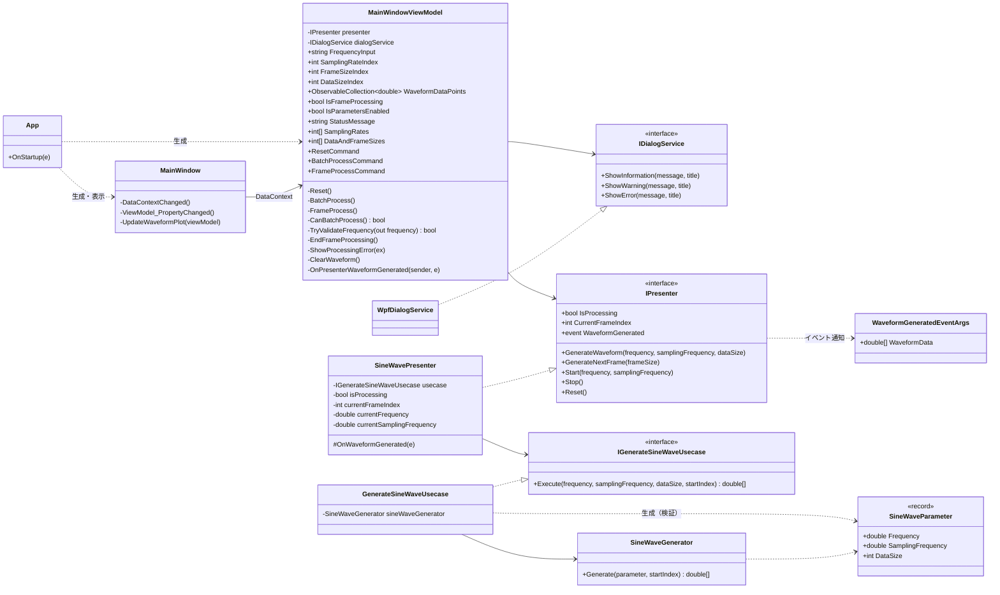
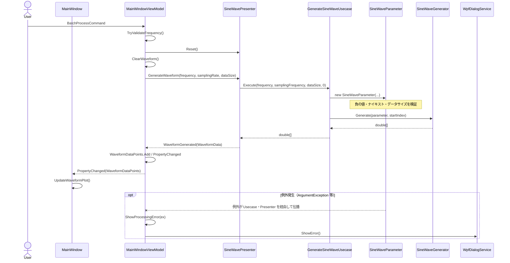
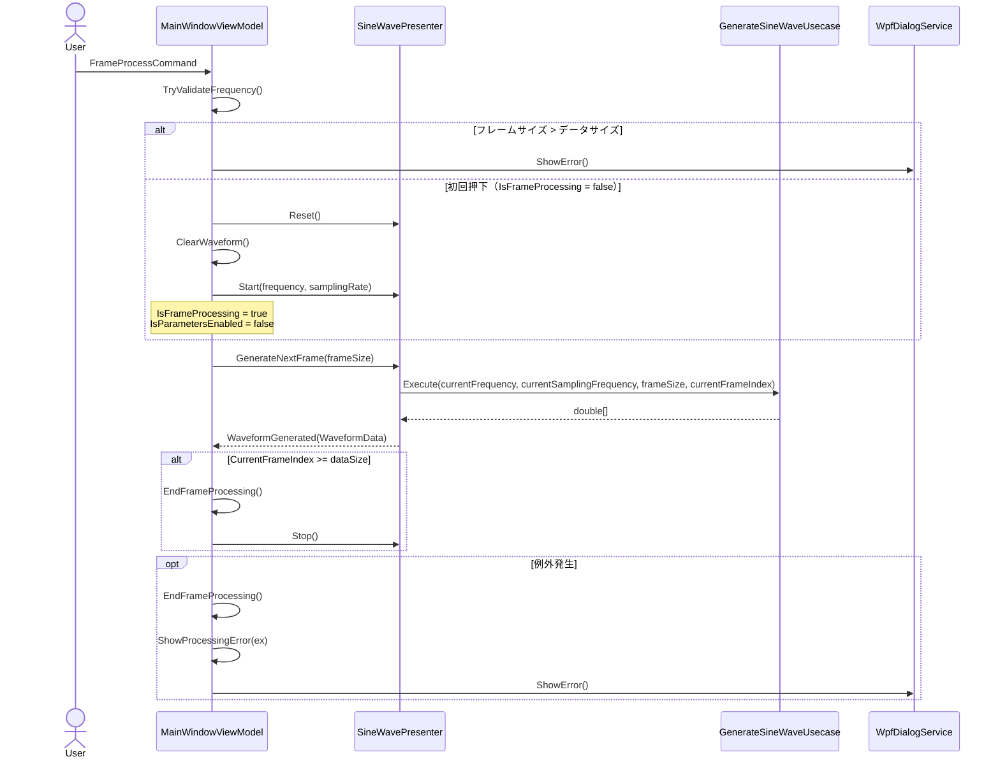
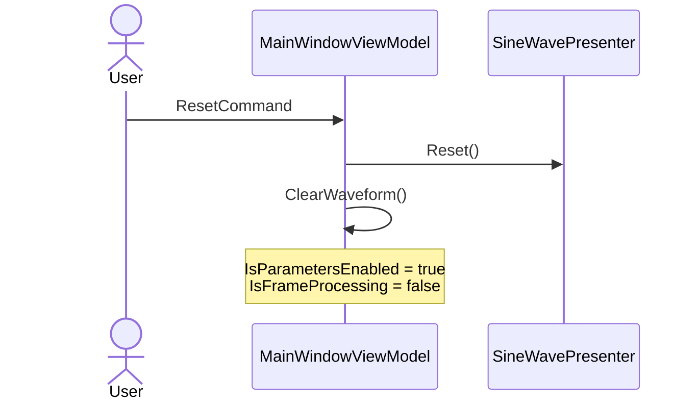

# クラス図とメソッド呼び出し関係

現時点のソースに基づく、レイヤ構成（View → ViewModel → Presenter → Usecase → Domain）の構造とメソッド呼び出しの関係。

## クラス図

## メソッド呼び出しシーケンス

### 一括処理

### フレーム処理（ボタン押下ごと）

### リセット

## 責務の概要

| レイヤ | クラス | 責務 |
| --- | --- | --- |
| View | `MainWindow` | ViewModel の変更通知を受けて ScottPlot を再描画する |
| ViewModel | `MainWindowViewModel` | 入力の保持・数値検証、コマンド処理、UI 状態管理、エラー表示 |
| Presenter | `SineWavePresenter` | 処理状態（処理中・フレーム位置）の管理、Usecase 呼び出し、結果のイベント通知 |
| Usecase | `GenerateSineWaveUsecase` | `SineWaveParameter` を生成して波形生成を委譲する |
| Domain | `SineWaveParameter` / `SineWaveGenerator` | パラメータ検証（負の値・ナイキスト・データサイズ）と正弦波の生成 |
